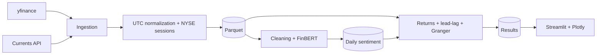

# Financial Sentiment Lab

A financial sentiment analysis pipeline that combines market news and stock
prices to study lead-lag relationships between news sentiment and returns.

## Architecture



## Project layout

```text
finsent/
  ingestion/   news and price clients
  storage/     schemas and Parquet persistence
  nlp/         text cleaning, FinBERT, and daily aggregation
  analysis/    session alignment, returns, lead-lag, and Granger
  pipeline/    pipeline orchestrators
  dashboard/   Streamlit application
config/        ticker and application settings
data/          raw, processed, cache, and sample data
tests/         unit and synthetic tests
```

## Requirements

- Python 3.12
- [uv](https://docs.astral.sh/uv/)

Install the pipeline dependencies:

```bash
uv venv --python 3.12
uv pip install -r requirements-pipeline.txt
```

## Usage

Run individual pipeline stages:

```bash
uv run python -m finsent ingest
uv run python -m finsent score
uv run python -m finsent analyze
```

Run the incremental pipeline through the latest completed NYSE session:

```bash
uv run python -m finsent daily
```

Start the dashboard:

```bash
uv run streamlit run streamlit_app.py
```

The `daily` command reads the last successfully processed session from
`data/processed/pipeline_state.json`, fetches news between session closes,
updates prices, scores only new articles, and recalculates the analysis. It
catches up on missed sessions after weekends, holidays, or failed runs.

On its first run (when no checkpoint exists), it bootstraps a 20-calendar-day
window ending on the latest completed session. Prices and news are aligned to
NYSE session boundaries: prices include one prior session as the seed for the
first log return, and news starts at that prior session close so the first
session includes overnight and pre-market articles. The news window is
half-open: it ends just before the target session close, so articles published
exactly at the closing bell belong to the next session. Tune
`ingestion.bootstrap_days` and `ingestion.news_overlap_sessions` in
`config/settings.yaml` if needed.

News ingestion uses the Currents API. Its free plan caps each search at 7
calendar days and 20 results, so the ingestion layer splits date ranges into
7-day windows and fetches up to `ingestion.news_max_pages` pages (3 by default)
per ticker and window. The 20-day bootstrap needs about 60 base requests and up
to 180 with pagination, below the free daily quota of 250.

Every later run re-fetches `news_overlap_sessions` (default 2) already processed
sessions before the checkpoint. Duplicate articles and sentiment rows are
discarded by the Parquet primary keys, so the overlap only recovers items that a
delayed Currents API response did not return on the previous run.

## First local bootstrap and GitHub Actions handoff

Run the first `daily` execution locally, then commit the generated Parquet files
and the checkpoint before enabling the scheduled workflow:

```bash
uv run python -m finsent daily
git add -f data/processed/*.parquet data/processed/pipeline_state.json
git commit -m "chore(data): bootstrap 20-day pipeline window"
git push
```

The processed data directory is ignored by Git, so `-f` is required. Upload the
Parquet files and the checkpoint together; committing only the checkpoint would
leave the scheduled run without historical data.

The scheduled workflow refuses to run when the bootstrap checkpoint or the core
Parquet tables are missing. This prevents a heavy bootstrap from running in CI.
Once the checkpoint is on the default branch, each scheduled run continues from
`last_processed_session` and only processes newer sessions.

Run the bootstrap before the next weekday 22:30 UTC scheduled run, or pause the
workflow while publishing, to avoid a local/CI race.

## Daily GitHub Actions workflow

The [daily pipeline workflow](.github/workflows/daily_pipeline.yml) is scheduled
for weekdays at 22:30 UTC and can also be started manually from the Actions tab.
It commits processed Parquet files and the session checkpoint back to the
repository, so repository history grows as data accumulates. Before running the
pipeline, it verifies that the local bootstrap data and checkpoint are present.

To enable it:

1. Add `CURRENTS_API_KEY` under the repository's **Settings → Secrets and
   variables → Actions**.
2. Set **Settings → Actions → General → Workflow permissions** to **Read and
   write permissions**.
3. Ensure the workflow is present on the repository's default branch.

GitHub Actions runs on a temporary runner. Committing processed data is how
this workflow persists results between runs; the dashboard does not fetch those
results from GitHub automatically.

## Dashboard

The dashboard reads analysis Parquet files from `data/processed` and displays
daily sentiment, log returns, lead-lag results, and Granger results. Use
**Reload data** after updating the files. If required tables are missing, the
app identifies them and tells you which pipeline stages to run.

## Environment variables

Copy `.env.example` to `.env` and add the credentials required for local runs:

```bash
cp .env.example .env
```

Do not commit `.env` or API keys. For GitHub Actions, configure
`CURRENTS_API_KEY` as a repository secret.

## Scope and status

The project currently focuses on news and market prices. Social media and
regulatory filings are out of scope. News ingestion, FinBERT scoring, daily
sentiment aggregation, return analysis, lead-lag analysis, Granger tests, and
the connected dashboard are implemented.
