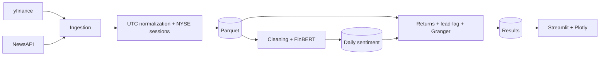

# Financial Sentiment Lab

A financial sentiment analysis pipeline that combines market news and stock
prices to study lead-lag relationships between news sentiment and returns.

## Architecture



## Project layout

```text
finsent/
  ingestion/   news and price clients
  storage/     schemas and Parquet persistence
  nlp/         text cleaning, FinBERT, and daily aggregation
  analysis/    session alignment, returns, lead-lag, and Granger
  pipeline/    pipeline orchestrators
  dashboard/   Streamlit application
config/        ticker and application settings
data/          raw, processed, cache, and sample data
tests/         unit and synthetic tests
```

## Requirements

- Python 3.12
- [uv](https://docs.astral.sh/uv/)

Install the pipeline dependencies:

```bash
uv venv --python 3.12
uv pip install -r requirements-pipeline.txt
```

## Usage

Run individual pipeline stages:

```bash
uv run python -m finsent ingest
uv run python -m finsent score
uv run python -m finsent analyze
```

Run the incremental pipeline through the latest completed NYSE session:

```bash
uv run python -m finsent daily
```

Start the dashboard:

```bash
uv run streamlit run streamlit_app.py
```

The `daily` command reads the last successfully processed session from
`data/processed/pipeline_state.json`, fetches news between session closes,
updates prices, scores only new articles, and recalculates the analysis. It
catches up on missed sessions after weekends, holidays, or failed runs. On its
first run, it downloads the configured price lookback and news from the prior
session close through the latest completed session.

## Daily GitHub Actions workflow

The [daily pipeline workflow](.github/workflows/daily_pipeline.yml) is scheduled
for weekdays at 22:30 UTC and can also be started manually from the Actions tab.
It commits processed Parquet files and the session checkpoint back to the
repository, so repository history grows as data accumulates.

To enable it:

1. Add `NEWSAPI_KEY` under the repository's **Settings → Secrets and variables
   → Actions**.
2. Set **Settings → Actions → General → Workflow permissions** to **Read and
   write permissions**.
3. Ensure the workflow is present on the repository's default branch.

GitHub Actions runs on a temporary runner. Committing processed data is how
this workflow persists results between runs; the dashboard does not fetch those
results from GitHub automatically.

## Dashboard

The dashboard reads analysis Parquet files from `data/processed` and displays
daily sentiment, log returns, lead-lag results, and Granger results. Use
**Reload data** after updating the files. If required tables are missing, the
app identifies them and tells you which pipeline stages to run.

## Environment variables

Copy `.env.example` to `.env` and add the credentials required for local runs:

```bash
cp .env.example .env
```

Do not commit `.env` or API keys. For GitHub Actions, configure `NEWSAPI_KEY` as
a repository secret.

## Scope and status

The project currently focuses on news and market prices. Social media and
regulatory filings are out of scope. News ingestion, FinBERT scoring, daily
sentiment aggregation, return analysis, lead-lag analysis, Granger tests, and
the connected dashboard are implemented.
