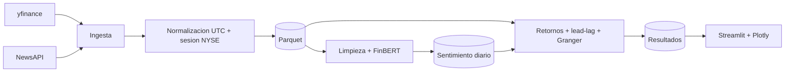

# Financial Sentiment Lab

Pipeline de analisis de sentimiento financiero que combina noticias y precios
bursatiles para estudiar relaciones lead-lag entre las noticias y los retornos.

## Arquitectura



## Estructura

```text
finsent/
  ingestion/   clientes de noticias y precios
  storage/     esquemas y persistencia Parquet
  nlp/         limpieza, FinBERT y agregacion diaria
  analysis/    alineacion, retornos, lead-lag y Granger
  pipeline/    orquestadores
  dashboard/   aplicacion Streamlit
config/        tickers y parametros
data/          raw, processed, cache y sample
tests/         pruebas unitarias y sinteticas
```

## Requisitos

- Python 3.12
- [uv](https://docs.astral.sh/uv/)

```bash
curl -LsSf https://astral.sh/uv/install.sh | sh
uv venv --python 3.12
uv pip install -r requirements-pipeline.txt
```

## Uso

```bash
uv run python -m finsent ingest
uv run python -m finsent score
uv run python -m finsent analyze
uv run streamlit run streamlit_app.py
```

## Variables de entorno

Copia `.env.example` a `.env` y completa las credenciales.

```bash
cp .env.example .env
```

## Estado

Proyecto centrado exclusivamente en noticias y precios. Las fuentes sociales y los
formularios regulatorios quedan fuera del alcance. La ingesta de precios y noticias, el
scoring FinBERT y la agregacion diaria estan implementados; retornos, lead-lag, Granger y
dashboard se completan de forma incremental.
