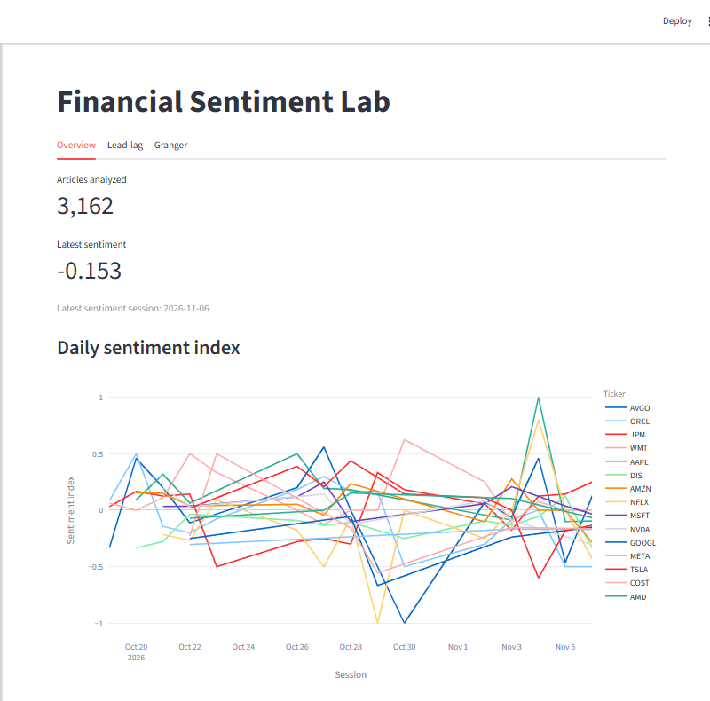
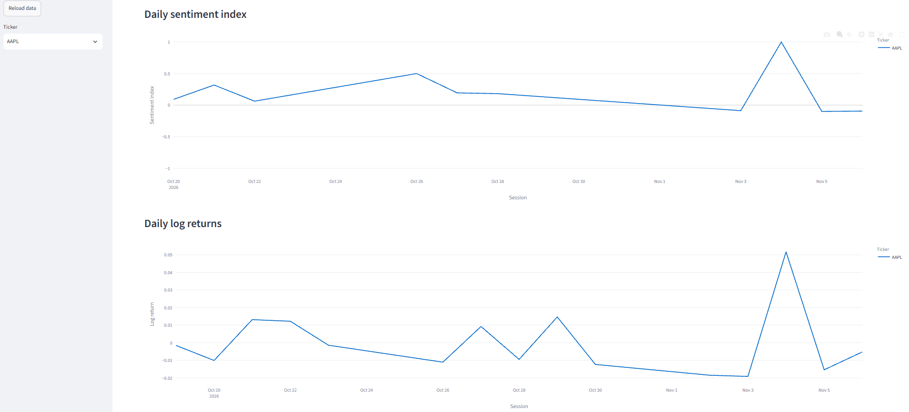
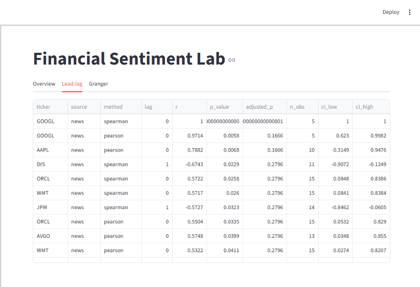
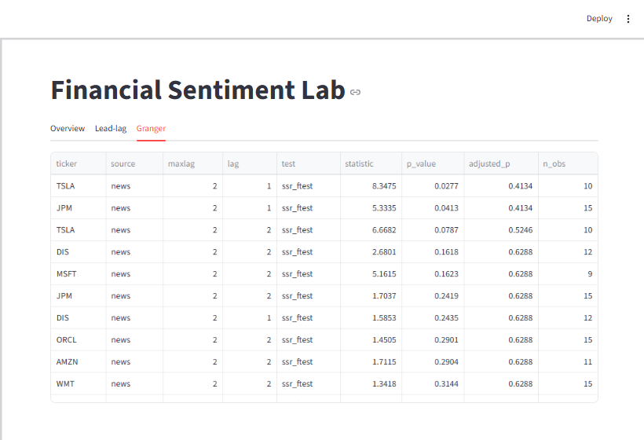
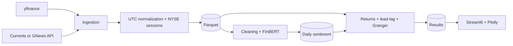

# Financial Sentiment Lab

An ongoing financial data project that combines market news, FinBERT sentiment
analysis, and stock returns to explore how news sentiment relates to market
behavior.

The project includes an automated data pipeline and an interactive dashboard.
It is designed to grow over time as new market sessions are collected.

## Dashboard preview

The screenshots show the current dashboard using the locally available
processed data. They are point-in-time examples; displayed values will change
as the dataset expands.


### Overview charts and ticker filtering


The overview shows the latest sentiment metrics, the daily sentiment index and the daily 
log returns for the selected tickers, giving a quick snapshot of the collected news data.




The first chart compares the daily sentiment index for the different tickers across time. It is obtained by using 
the model FinBERT to analyze different news related to tickers


<p align="center">
  
  <br><em>Daily log returns</em>
  <br>Each line represents a ticker's daily log return, making it easier to compare their movements across market sessions.
</p>

<p align="center">
  
  <br><em>Sentiment and returns filtered to AAPL</em>
  <br>With AAPL selected, the dashboard shows its daily sentiment index and log returns, aligned by trading session.
</p>

The second chart compares daily log returns across tickers. The third filters
the dashboard to AAPL, so its daily sentiment index and log returns can be
viewed together over the same period.


### Granger and lead lag correlation analysis

<table>
  <tr>
    <td align="center">
      
      <br><em>Lead-lag analysis</em>
      <br><small>Correlation results summarize the relationship between sentiment and returns at different session lags, including adjusted p-values and observation counts.</small>
    </td>
    <td align="center">
      
      <br><em>Granger analysis</em>
      <br><small>Granger test statistics show whether past sentiment helps explain returns at tested lags; with the current small sample, these results are exploratory.</small>
    </td>
  </tr>
</table>


## Project status and data limitations

This is a long-term project: a scheduled GitHub Actions workflow is set up to
collect and process new data on weekdays. After the initial local bootstrap
and workflow setup, each successful run updates the processed data and its
checkpoint so the historical dataset can keep growing.

There are currently too few observations to take the analysis results
seriously. Daily sentiment indices, lead-lag correlations, and Granger test
results are preliminary and should not be treated as reliable conclusions.
The project needs a substantially larger dataset before these results can be
meaningfully assessed.


## What it does

- Ingests stock prices from yfinance and financial news from Currents or GNews.
- Normalizes timestamps to UTC and assigns news to NYSE trading sessions.
- Cleans article text and scores it with FinBERT.
- Aggregates article sentiment by ticker and session.
- Calculates log returns, lead-lag correlations, and Granger tests with
  false-discovery-rate correction.
- Presents the processed data and analysis in a Streamlit dashboard.

## Scope

The project currently collects and processes financial news and market-price data for a configurable set of stocks. Its primary focus is to build a growing, reliable historical dataset through automated daily ingestion. As the dataset expands, it will provide a stronger foundation for analyzing how news sentiment relates to market returns and for evaluating predictive approaches.

## Future plans

- **Move data storage to the cloud:** keep the repository focused on code and
  use cloud storage for the growing historical dataset.
- **Add predictive modeling:** once enough data has accumulated, evaluate
  whether sentiment can support reliable out-of-sample predictions.
- **Backfill historical data:** extend the current dataset further into the
  past while preserving the existing data format and pipeline.
- **Publish the dashboard online:** keep a hosted version available so it can
  be explored without cloning or downloading the repository.


## How the pipeline works



The daily command processes data through the latest completed NYSE session.
Its first run bootstraps a configurable **20-calendar-day** window by default
(this is not 20 trading sessions). Prices include a prior session to seed the
first log return. News is assigned to sessions using exchange close times.

After bootstrap, the pipeline uses a checkpoint to continue from the last
successfully processed session and catches up after missed runs. It re-fetches
a small overlap of recent sessions to recover delayed news; duplicate articles
and sentiment rows are discarded.

## Quick start

### Requirements

- Python 3.12
- [uv](https://docs.astral.sh/uv/)
- An API key for the configured news provider (`CURRENTS_API_KEY` by default)

### Install and configure

```bash
uv venv --python 3.12
uv pip install -r requirements-pipeline.txt
cp .env.example .env
```

Add your news provider API key to `.env`. Use `GNEWS_API_KEY` if
`ingestion.news_provider` is set to `gnews` in `config/settings.yaml`.

### Bootstrap data and open the dashboard

The repository does not include a ready-to-use sample dataset. Run the daily
pipeline once to fetch and process the initial data:

```bash
uv run python -m finsent daily
uv run streamlit run streamlit_app.py
```

The first run also downloads FinBERT model files and scores the collected
articles, so it may take longer than subsequent runs. The dashboard reads
Parquet files from `data/processed`; without those files, there is no local
history to display.

Individual pipeline stages are available when needed:

```bash
uv run python -m finsent ingest
uv run python -m finsent score
uv run python -m finsent analyze
```

## Automated data collection

The [daily pipeline workflow](.github/workflows/daily_pipeline.yml) is
scheduled for weekdays at **22:30 UTC** and can also be started manually from
the GitHub Actions tab. It updates the processed Parquet files and checkpoint
in the repository, allowing data to persist between temporary GitHub Actions
runners.

Before enabling the scheduled workflow:

1. Run `uv run python -m finsent daily` locally for the initial bootstrap.
2. Commit and push the processed tables and checkpoint:

   ```bash
   git add -f data/processed/*.parquet data/processed/pipeline_state.json
   git commit -m "chore(data): bootstrap pipeline"
   git push
   ```

3. Add the selected provider key (`CURRENTS_API_KEY` or `GNEWS_API_KEY`) under
   the repository's **Settings → Secrets and variables → Actions**.
4. Set **Settings → Actions → General → Workflow permissions** to **Read and
   write permissions**, and ensure the workflow is on the default branch.

The workflow checks for the bootstrap checkpoint and required Parquet tables
before running. It will not start a bootstrap on its temporary runner. The
dashboard reads local files; it does not fetch the workflow's data from GitHub
automatically. To view newer results locally, pull the repository changes and
reload the dashboard.

## News providers

Currents is the default provider. Its free plan limits searches to 7 calendar
days and 20 results, so the pipeline splits date ranges into 7-day windows and
fetches up to `ingestion.news_max_pages` pages per ticker and window (3 by
default).

GNews can be selected with `ingestion.news_provider: gnews`. Its settings use
7-day windows by default, up to 10 articles per request, and one page per
ticker and window. The free plan has a 100-request daily quota, limits history
to 30 days, and may not return articles from the most recent 12 hours. For
near-real-time daily runs, use Currents or a GNews plan without that delay.

Other ingestion settings, including tickers, model, date windows, and analysis
lags, are in `config/settings.yaml` and `config/tickers.yaml`.

## Project structure

```text
finsent/
  ingestion/   news and price clients
  storage/     schemas and Parquet persistence
  nlp/         text cleaning, FinBERT, and daily aggregation
  analysis/    session alignment, returns, lead-lag, and Granger
  pipeline/    pipeline orchestrators
  dashboard/   Streamlit application
config/        ticker and application settings
data/          raw, processed, cache, and sample data
docs/images/   dashboard screenshots used in this README
tests/         unit and synthetic tests
```

## Environment variables

`.env.example` lists the supported local variables:

- `CURRENTS_API_KEY` — required when using Currents.
- `GNEWS_API_KEY` — required when using GNews.
- `HF_TOKEN` — optional Hugging Face token for model downloads.

Never commit `.env` or API keys. For GitHub Actions, configure the selected
provider key as a repository secret.


